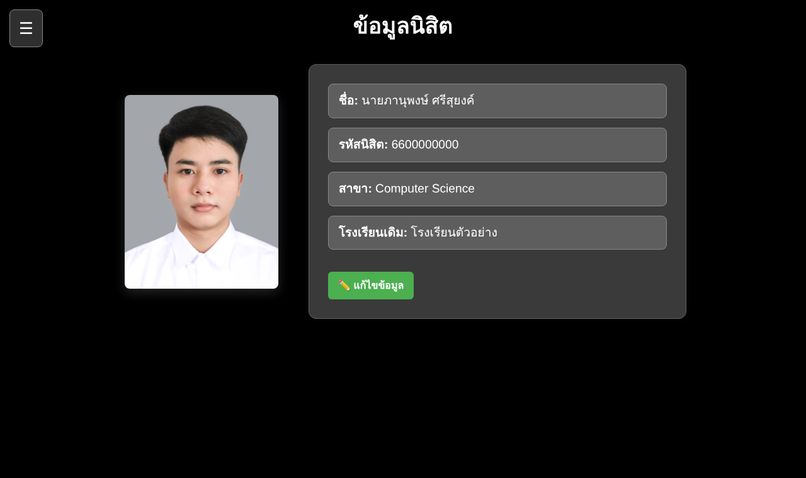
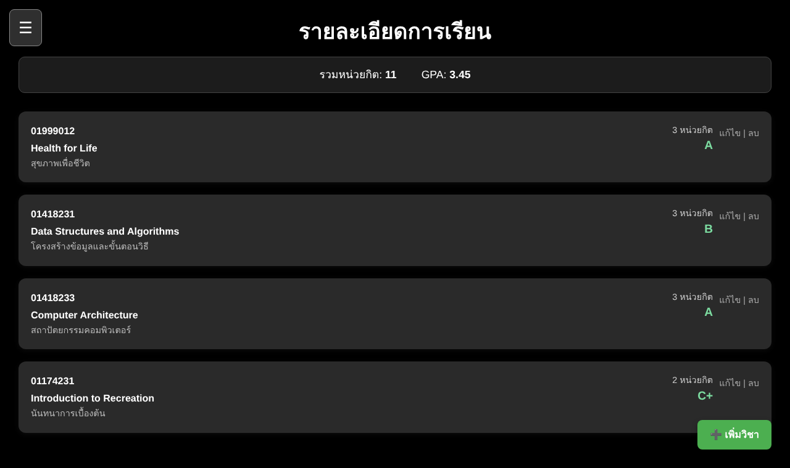
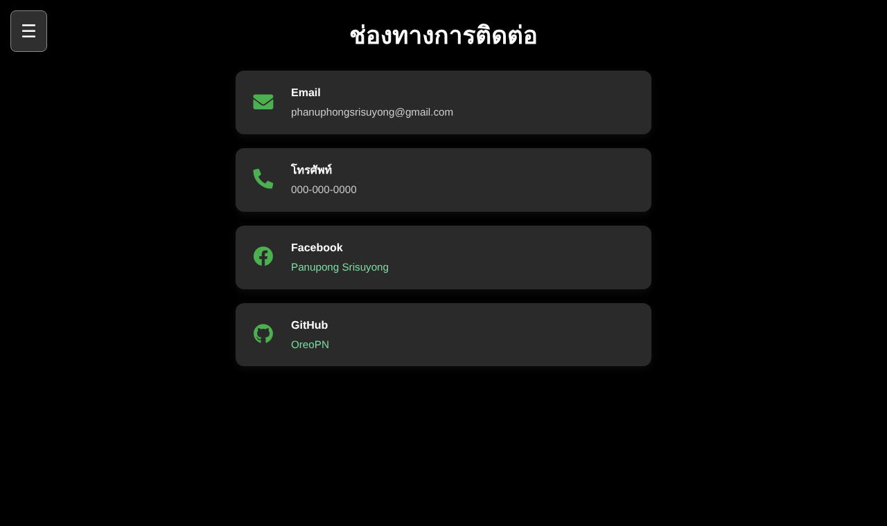

# Student Portfolio (Vue 3)

เว็บพอร์ตโฟลิโอส่วนตัวสำหรับนิสิต — แนะนำตัว ดูและแก้ไขข้อมูลนิสิต จัดการรายวิชา (เพิ่ม/แก้ไข/ลบ) พร้อมคำนวณหน่วยกิตรวมและ GPA อัตโนมัติ

A single-page personal portfolio built with Vue 3 + Vite. It has an intro page with an image carousel, an editable student profile,
a course manager (create / edit / delete) with automatic total credits and GPA, and a contact page.

> ข้อมูลในไฟล์ `data/db.json` (รหัสนิสิต โรงเรียน เบอร์โทร) เป็นค่าสมมติเพื่อการแสดงผลงาน
> The student ID, school and phone number in this repository are placeholders.

| หน้าหลัก | ข้อมูลนิสิต |
|---|---|
|  |  |

| รายละเอียดการเรียน | ช่องทางการติดต่อ |
|---|---|
|  |  |

## ความสามารถ / Features

| หน้า | Route | รายละเอียด |
|---|---|---|
| หน้าหลัก | `/` | แนะนำตัว ความสนใจ ทักษะ และสไลด์รูปอัตโนมัติ (`vue3-carousel`) |
| ข้อมูลนิสิต | `/student-list` | แสดงชื่อ รหัสนิสิต สาขา โรงเรียนเดิม กด "แก้ไขข้อมูล" เพื่อแก้และบันทึกผ่าน API (`PUT /student`) |
| รายละเอียดการเรียน | `/course-list` | รายการวิชา เพิ่มวิชาผ่าน Popup แก้ไขแบบ Inline ลบพร้อมหน้าต่างยืนยัน สรุปหน่วยกิตรวมและ GPA |
| ช่องทางการติดต่อ | `/my-contact` | อีเมล โทรศัพท์ Facebook และ GitHub |

- **คำนวณ GPA** จากเกรด × หน่วยกิต (A = 4, B+ = 3.5, B = 3, C+ = 2.5, C = 2, D+ = 1.5, D = 1, F = 0) ข้ามวิชาที่ไม่มีเกรดที่รู้จัก
- เมนูด้านข้าง (Sidebar) เปิด/ปิดด้วยปุ่ม ☰ ใช้ `vue-router` สลับหน้าโดยไม่โหลดหน้าใหม่
- ข้อมูลทั้งหมดมาจาก REST API ที่ `http://localhost:3000` (ใช้ `json-server` อ่าน/เขียน `data/db.json`)

## เทคโนโลยี / Tech stack

- Vue 3 (Options API), Vue Router 4
- Vite 6, `@vitejs/plugin-vue`
- Bootstrap 5, Font Awesome, `vue3-carousel`
- `json-server` เป็น Mock REST API (ไม่ได้อยู่ใน `package.json` รันผ่าน `npx`)

## โครงสร้าง / Structure

```
data/db.json            ข้อมูล student และ courses (ใช้กับ json-server)
src/
  main.js               สร้างแอปและติดตั้ง router
  App.vue               โครงหน้า: MainMenu + <router-view>
  router/index.js       4 routes
  components/
    MainMenu.vue        Sidebar + ปุ่ม ☰
    MyPortfolio.vue     หน้าหลัก
    MyImageSlider.vue   สไลด์รูป
    StudentList.vue     ข้อมูลนิสิต (GET/PUT /student)
    CourseList.vue      รายวิชา (GET/POST/PUT/DELETE /courses) + GPA
    MyContact.vue       ช่องทางติดต่อ
docs/                   ภาพหน้าจอ
```

## วิธีรัน / Getting started

ต้องมี [Node.js](https://nodejs.org/) 18 ขึ้นไป

```sh
# 1) ติดตั้ง
npm install

# 2) เปิด API จำลอง (เทอร์มินัลที่ 1) — ต้องเป็นพอร์ต 3000
npx json-server@0.17.4 data/db.json --port 3000

# 3) เปิดเว็บ (เทอร์มินัลที่ 2)
npm run dev
```

เปิด http://localhost:5173 — ถ้าไม่เปิด API ในข้อ 2 หน้า "ข้อมูลนิสิต" และ "รายละเอียดการเรียน" จะแสดงข้อมูลว่าง

สร้างไฟล์สำหรับ Production: `npm run build` (ผลลัพธ์อยู่ใน `dist/`) และดูตัวอย่างด้วย `npm run preview`

### API ที่ใช้ / Endpoints

| Method | URL | ใช้ทำอะไร |
|---|---|---|
| GET / PUT | `/student` | อ่าน / บันทึกข้อมูลนิสิต |
| GET / POST | `/courses` | รายการวิชา / เพิ่มวิชา |
| PUT / DELETE | `/courses/:id` | แก้ไข / ลบวิชา |

## หมายเหตุ / Notes

- รูปภาพใน `src/assets/` เป็นรูปของเจ้าของโปรเจกต์
- ที่อยู่ API ถูกเขียนตรงในคอมโพเนนต์ (`http://localhost:3000`) — ถ้าจะนำไปใช้งานจริงควรย้ายไปไว้ในตัวแปรสภาพแวดล้อม (`import.meta.env`)
- โปรเจกต์นี้เป็นงานเรียน/ตัวอย่างผลงาน ไม่มีระบบล็อกอิน

## License

Educational / portfolio project.
